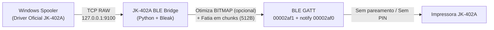

<div align="center">
  
  <h1>JK-402A BLE Print Bridge</h1>
  <p>
    <strong>Ponte TCP RAW (<code>127.0.0.1:9100</code>) → Bluetooth Low Energy (BLE) para imprimir na impressora térmica JK-402A no Windows usando o driver oficial.</strong>
  </p>

  
  
  
  
  
</div>

---

## Por que este projeto existe?

A impressora térmica de etiquetas **JK-402A** (módulo Bluetooth `HS6602M`) funciona perfeitamente via **USB** com o driver oficial do Windows (que gera comandos **TSPL**). Porém, ao tentar imprimir via Bluetooth usando a porta COM virtual (**SPP**) do Windows, o módulo recusa autenticação/PIN e o spooler trava.

Por outro lado, a JK-402A expõe um canal **Bluetooth Low Energy (BLE)** aberto que aceita conexões **GATT sem pareamento nem PIN**.

Este projeto cria um servidor ponte local que:
1. Escuta na porta **TCP `127.0.0.1:9100`** (protocolo **RAW**, compatível com *Standard TCP/IP Port* do Windows).
2. Recebe os bytes brutos gerados pelo **driver oficial da JK-402A** (etiquetas da Shopee, Mercado Livre, Correios, PDFs, etc.).
3. Ativa `notify` na característica `00002af0` e envia os dados em pacotes BLE otimizados (`MTU=516`, até `512B` por chunk) para `00002af1` via [`bleak`](https://github.com/hbldh/bleak).



---

## Funcionalidades

- **Interface na Bandeja do Windows (System Tray)**: ícone com status ao vivo (*Ativo*, *Processo externo* ou *Parado*) e log em tempo real.
- **Ajuste ao vivo de Chunks & Velocidade**: presets prontos (`180B/20ms`, `480B/15ms`, `512B/5ms`, `512B/0ms`) ou configuração personalizada sem reiniciar.
- **Recorte automático de margens brancas (`BITMAP` TSPL)**: opção ativável na interface para remover linhas `0xFF` no topo/rodapé e acelerar o envio sem perda visual.
- **Execução silenciosa + Auto-iniciar com o Windows**: roda via `pythonw.exe` sem janela preta do terminal e pode iniciar minimizado em `shell:startup`.
- **Instalador Windows (`.exe`) com NSIS**: verifica se o Python 3.10+ está instalado e, caso não esteja, baixa e instala automaticamente antes de criar a `.venv`.
- **Scanner de diagnóstico (`scan_jk.py`)**: lista serviços/características GATT para adaptar facilmente a outras impressoras térmicas BLE.

---

## 1. Pré-requisito Importante no Windows

> [!IMPORTANT]
> **Despareie a JK-402A das configurações de Bluetooth do Windows!**
> Se a impressora estiver pareada no Windows (de tentativas anteriores via porta COM/SPP), o Windows tentará negociar criptografia BLE ao conectar e a impressora derrubará a conexão em ~3 segundos.
> 1. Vá em **Configurações** → **Bluetooth e dispositivos** → **Dispositivos**.
> 2. Se **JK-402A** aparecer na lista, clique em **Remover dispositivo**.
> 3. **Não pareie novamente.** Deixe apenas o Bluetooth do notebook/PC ligado.

---

## 2. Instalação

### Opção A — Instalador Windows (Recomendado)
1. Baixe e execute `JK402A-BLE-Bridge-Setup.exe` (em `Releases` ou gere em `dist/`).
2. O instalador instala em `%LOCALAPPDATA%\Programs\JK402A-BLE-Bridge`, baixa/instala o Python 3.13 caso você ainda não tenha, cria a `.venv` e instala as dependências.
3. Marque se deseja **Iniciar automaticamente com o Windows** e abrir o painel na bandeja ao concluir.

### Opção B — Pelo código-fonte (Python 3.10+)
```powershell
git clone https://github.com/SEU_USUARIO/JK402A-BLE-Bridge.git
cd JK402A-BLE-Bridge

python -m venv .venv
.\.venv\Scripts\pip.exe install -r requirements.txt
```

Para abrir o painel na bandeja (System Tray):
```powershell
.\.venv\Scripts\pythonw.exe jk402a_tray.pyw
```

Ou rodar apenas o serviço no terminal (útil para debug):
```powershell
.\.venv\Scripts\python.exe jk402a_bridge.py --verbose
```

---

## 3. Configurando a Impressora no Windows (Porta `127.0.0.1:9100`)

Com o **JK-402A BLE Bridge** rodando (ícone verde na bandeja):

1. Instale normalmente o **driver oficial da JK-402A** (o mesmo usado via USB).
2. Abra **Configurações** → **Bluetooth e dispositivos** → **Impressoras e scanners**.
3. Clique em **Adicionar dispositivo** → **Adicionar manualmente** (*A impressora que eu quero não está listada*).
4. Selecione **Adicionar uma impressora local ou de rede com configurações manuais**.
5. Escolha **Criar uma nova porta** → Tipo: **`Standard TCP/IP Port`** → Avançar.
6. Em **Nome do host ou endereço IP**, digite:
   ```text
   127.0.0.1
   ```
   *(Desmarque "Consultar a impressora e selecionar automaticamente o driver a ser usado".)*
7. Na tela **Informações adicionais de porta necessárias**:
   - Selecione **Personalizado** → **Configurações...**
   - **Protocolo**: `RAW`
   - **Número da porta**: `9100`
   - **Desmarque** *Status SNMP habilitado*
8. Na escolha do driver, selecione **`JK-402A Driver`** (ou o nome do driver instalado da sua impressora).
9. Conclua e envie uma **Página de Teste**.

> [!TIP]
> **Para etiquetas da Shopee / Mercado Livre (100 × 150 mm):** confira nas **Preferências de Impressão** da impressora que o tamanho do papel está definido como `100 x 150 mm` (ou `4 x 6 in`).

---

## 4. Usando em Outra Impressora BLE (Descobrir MAC e UUID)

Você pode descobrir e selecionar o **MAC** e o **UUID de escrita** direto pela interface na bandeja (sem mexer em código):
1. Abra o painel do **JK-402A BLE Bridge** no System Tray.
2. Clique em **Buscar BLE** e selecione sua impressora na lista.
3. Clique em **Listar UUIDs** para preencher as características graváveis e selecionar a recomendada automaticamente.
4. Clique em **Salvar & Aplicar**.

*(Se preferir pelo terminal, o script `scan_jk.py` continua disponível:)*

1. Rode o scanner com a impressora ligada:
   ```powershell
   .\.venv\Scripts\python.exe scan_jk.py
   ```
2. Se não encontrar pelo MAC padrão (`66:32:33:64:76:48`), o script lista todos os dispositivos BLE próximos com seus respectivos endereços MAC.
3. Passe o MAC e/ou UUID encontrados via variáveis de ambiente ou argumentos CLI:
   ```powershell
   .\.venv\Scripts\python.exe scan_jk.py --mac AA:BB:CC:DD:EE:FF --test-write
   .\.venv\Scripts\python.exe jk402a_bridge.py --mac AA:BB:CC:DD:EE:FF --uuid 00002af1-0000-1000-8000-00805f9b34fb
   ```
   Ou edite `DEFAULT_MAC_ADDRESS` e `DEFAULT_WRITE_UUID` em [`src/config.py`](src/config.py).

---

## 5. Estrutura do Projeto

```text
IMP_CONECT/
├── assets/                     # Ícones do app (logo.png, logo.ico)
├── src/                        # Código-fonte principal
│   ├── __init__.py
│   ├── config.py               # Configurações, env vars e JSON (bridge_settings.json)
│   ├── ble_utils.py            # Descoberta GATT, chunking e recorte de BITMAP TSPL
│   ├── scan_jk.py              # Diagnóstico de serviços/características BLE
│   ├── bridge.py               # Servidor TCP 127.0.0.1:9100 -> Worker BLE
│   └── tray_app.py             # Interface Tkinter + ícone System Tray (pystray)
├── scripts/                    # Automação PowerShell no Windows
│   ├── start_background.ps1    # Inicia minimizado no System Tray
│   ├── stop_bridge.ps1         # Encerra instâncias em execução
│   ├── install_startup.ps1     # Cria/remove atalho em shell:startup
│   └── build_installer.ps1     # Compila o instalador NSIS
├── installer/                  # Empacotamento Windows (NSIS)
│   ├── jk402a_bridge.nsi       # Script do instalador MUI2
│   └── setup_env.ps1           # Verifica/baixa Python 3.13 + cria .venv + pip install
├── tests/                      # Testes unitários (unittest)
│   └── test_bridge.py
├── jk402a_bridge.py            # Wrapper CLI (ponte em terminal)
├── jk402a_bridge.pyw           # Wrapper silencioso (sem janela)
├── jk402a_tray.pyw             # Wrapper silencioso da interface System Tray
├── scan_jk.py                  # Wrapper CLI do scanner BLE
├── requirements.txt
├── LICENSE
└── README.md
```

---

## 6. Testes e Compilação do Instalador

Rodar os testes unitários:
```powershell
.\.venv\Scripts\python.exe -m unittest discover -s tests -v
```

Recompilar o instalador Windows (requer [NSIS 3.x](https://nsis.sourceforge.io/) instalado):
```powershell
.\scripts\build_installer.ps1
```
O executável é gerado em `dist/JK402A-BLE-Bridge-Setup.exe`.

---

## 7. Solução de Problemas

| Sintoma | Causa provável | Como resolver |
| :--- | :--- | :--- |
| Desconecta após ~3 segundos | Impressora ainda pareada no Bluetooth do Windows | Remova a **JK-402A** em *Bluetooth e dispositivos* e não pareie novamente |
| Envia tudo mas não imprime | `notify` desativado ou taxa muito rápida | Use o UUID `00002af1-...` (já ativa `00002af0`); se cortar o fim da etiqueta, teste o preset `180B / 20ms` |
| Porta `9100` já está em uso | Já há outra instância rodando em segundo plano | Rode `.\scripts\stop_bridge.ps1` ou clique em **Parar** no painel |
| Ícone não aparece na bandeja | Executado via `python.exe` com janela fechada | Inicie usando `jk402a_tray.pyw` via `pythonw.exe` ou `.\scripts\start_background.ps1` |

---

## Licença

Distribuído sob a licença **MIT**. Veja [`LICENSE`](LICENSE) para mais detalhes.
